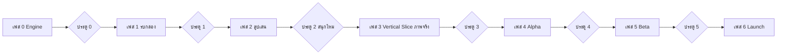

# 18 แผนพัฒนาแบบเฟส + ประตูตัดสินใจ (Phase & Gate Plan)

**หลักการ**
- ทุกเฟสจบด้วย **ประตู (Gate)** ผู้ออกแบบต้อง **เล่นเอง** แล้วตัดสิน: ✅ ไปต่อ / 🔧 แก้ก่อน / ❌ ตัดทิ้ง-เปลี่ยนแนว
- **ห้ามจ่ายค่าภาพ/เสียงจนกว่าจะผ่านประตู 2** เฟส 0–2 ใช้ **กล่องสี่เหลี่ยมสี + ตัวอักษร** แทนภาพทั้งหมด (สีกล่อง = ธาตุ, ตัวอักษรบนกล่อง = ชื่อสัตว์/คลาส)
- ทำทีละเฟส เฟสถัดไปเริ่มเมื่อประตูก่อนหน้าผ่านเท่านั้น
- ข้อมูลฮีโร่/สกิล/อัตราดรอปเป็น JSON ตั้งแต่วันแรก (ปรับบาลานซ์ไม่ต้องแก้โค้ด)

**สแตกที่แนะนำ:** TypeScript + Vite · Phaser 3 (ฉากรบ) · React (เมนู/UI) · Combat engine เป็นโมดูล TS แยก ใช้ร่วมกับซิมูเลเตอร์และเซิร์ฟเวอร์ภายหลัง

---

## เฟส 0 — Combat Engine + ซิมูเลเตอร์ (ไม่มีกราฟิก)
**เป้าหมาย:** ย้ายกฎการรบจาก `sim/*.js` เป็น engine TypeScript ตัวจริงที่ใช้ได้ทั้งเกมและซิมูเลเตอร์

**งาน**
- โครงโปรเจกต์ Vite + TS, โฟลเดอร์ `engine/`, `data/`
- `data/heroes.json` (12 ตัวตาม 17), `skills.json` (Skill Board 10 ธาตุ), `elements.json` (ตาราง 05)
- Engine: STR/AGI/STA → ค่าอนุพันธ์, HIT/FLEE, CRI, Armor Break/Block, ธาตุ ×1.3/×0.85, สกิล 4 ช่อง, เกจประจำตัว (SS เริ่ม 30 +3)
- สถานะผิดปกติ (ไฟไหม้ พิษ สตัน แช่แข็ง ตรึง ฯลฯ) + ค่าต้านทานสะสม
- ทีม 2 ตัว + ตัวสำรอง + ปุ่มสลับตัว (1 ครั้ง/3 เทิร์น)
- Combat Log เป็นข้อความ
- คำสั่ง CLI: `npm run sim` ได้ตาราง win-rate แบบเดียวกับ 17

**ประตู 0 (เล่นเอง ~15 นาที)**
- รัน `npm run sim` → ตัวเลขใกล้กับ 17 (±3%) ไหม? ถ้าต่างมาก เพราะเพิ่มสถานะผิดปกติ/ตัวสำรอง → ต้องจูนใหม่ก่อนไหม
- อ่าน Combat Log 2–3 ไฟต์ → เข้าใจทุกบรรทัดไหม? ผลสุ่มดู "ยุติธรรม" ไหม
- ✅ ไปต่อเมื่อ: ตัวเลขยอมรับได้ และ log อ่านรู้เรื่อง

---

## เฟส 1 — รบด้วยกล่องสี่เหลี่ยม (Graybox Battle)
**เป้าหมาย:** เห็นและ "รู้สึก" การรบ 1 ไฟต์บนเบราว์เซอร์

**งาน**
- ฉาก Phaser: กล่องซ้าย vs กล่องขวา (สีตามธาตุ), แถบ HP, แถบเกจประจำตัว, ตัวสำรองเป็นกล่องเล็ก
- ตัวเลขดาเมจเด้ง, คำว่า MISS / CRIT / BLOCK, กล่องกระพริบเมื่อโดน, สั่นเมื่อสกิลใหญ่
- ปุ่ม: กดสกิลประจำตัว · สลับตัว · x1/x2/x3 · Auto-cast
- ลูกศรเขียว/แดงบอกธาตุได้/เสียเปรียบก่อนเริ่ม
- หน้าเลือกทีมแบบง่าย: เลือก 2 ตัวจาก 12 + จัดสกิล 4 ช่อง จาก dropdown
- ศัตรูเลือกสุ่ม/กำหนดเอง (โหมดทดสอบ)

**ประตู 1 (เล่นเอง ~30 นาที, ≥10 ไฟต์)**
- ไฟต์ยาว 30–90 วินาทีไหม (x1)?
- การกดสกิลประจำตัว "รู้สึกว่ามีผล" ไหม? อยากกดรอจังหวะไหม?
- สลับตัวเพื่อเอาธาตุได้เปรียบ "รู้สึกฉลาด" ไหม?
- จัดสกิล 4 ช่องต่างกัน รู้สึกต่างกันไหม?
- อยากกด "อีกไฟต์" เองโดยไม่ต้องบังคับไหม?
- ✅ ไปต่อเมื่อ: ตอบ "ใช่" อย่างน้อย 4/5 ข้อ · 🔧 ถ้ารบน่าเบื่อ → กลับแก้จังหวะ/feedback ก่อน ห้ามเพิ่มระบบอื่น

---

## เฟส 2 — ลูปการเล่นครบ (Graybox Core Loop) ⭐ ประตูสำคัญที่สุด
**เป้าหมาย:** พิสูจน์ว่า **ลูปทั้งหมดสนุก** ก่อนจ่ายเงินค่าภาพ — ยังเป็นกล่องทั้งหมด

**งาน**
- **ด่านบท 1:** 10–15 ด่าน เป็นปุ่มบนแผนที่สี่เหลี่ยม, บอสท้ายบท
- **ฟักไข่:** ไข่ธรรมดา/ทอง ตามอัตรา 08, เวลาฟัก (เร่งได้ในโหมดทดสอบ), Pity, ซ้ำ → เศษวิญญาณ
- **Skill Board:** แถวธาตุ + ปลดสกิลด้วยเหรียญ/คัมภีร์/หินธาตุ, Preset
- **Progression:** เลเวล (เสบียง), ดาว (เศษวิญญาณ)
- **เศรษฐกิจตัวเลขจริงชุดแรก:** รายได้ต่อด่าน, ราคาปลด, ราคาอัป (สเปรดชีต → JSON)
- เซฟใน localStorage (ยังไม่มีเซิร์ฟเวอร์)
- หน้าแสดงอัตราดรอปโปร่งใส

**ประตู 2 (เล่นเอง 3–5 วัน วันละ ~20 นาที + ให้คนอื่น 3–5 คนลองถ้าเป็นไปได้)**
- เล่นจบบท 1 ได้โดยไม่รู้สึกถูก "กั้น" ไหม?
- ตอนฟักไข่ลุ้นไหม (แม้เป็นกล่อง)?
- ได้ตัวใหม่แล้ว อยากลองจัดทีม/สกิลใหม่ไหม?
- วันที่ 2–3 อยากกลับมาเล่นเองไหม?
- มีจุดไหนน่าเบื่อ/ฟาร์มซ้ำเกินไป (จดไว้)
- B/A ยังมีที่ใช้ไหม หรือทิ้งทันทีเมื่อได้ S?
- ✅ ไปต่อ (และเริ่มจ้างภาพ) เมื่อ: กลับมาเล่นเองโดยไม่ต้องบังคับ + ลูปไม่มีจุดตันใหญ่
- ❌ ถ้าไม่สนุกด้วยกล่อง → **ภาพสวยไม่ช่วย** กลับแก้ระบบ (เฟส 1–2) ห้ามข้าม

---

## เฟส 3 — Vertical Slice (ภาพ/เสียงจริง 1 บท)
**เป้าหมาย:** คุณภาพจริงเท่าที่จะปล่อย แต่เฉพาะบท 1

**งาน**
- Art Direction: cozy pixel art (12) — ทำ style guide + ฮีโร่ 2–3 ตัวก่อน แล้วค่อยขยาย
- ฮีโร่ 15 ตัว (sprite + idle/โจมตี/โดน/สกิล), เทมเพลตแอนิเมชันใช้ร่วม
- UI จริงทุกหน้า, ฉากฟักไข่สวย (SS มีฉากพิเศษ), เสียง/เพลง
- Active Story บท 1: Cutscene เปิดได้/ข้ามได้, หนังสือ, สารานุกรมสัตว์
- Tutorial แบบไม่บังคับ
- ทดสอบบนมือถือ (Chrome/Safari) — FPS, ขนาดโหลด

**ประตู 3 (เล่นบนมือถือจริง + คนนอก 5–10 คน)**
- ภาพ/เสียงทำให้สนุกขึ้นจากเฟส 2 ชัดเจนไหม?
- โหลดครั้งแรก < 10 วินาที บน 4G ไหม? ลื่นบนมือถือกลางๆ ไหม?
- คนนอกเข้าใจเกมโดยไม่ต้องอธิบายไหม?
- ต้นทุนภาพ 1 ตัว × 40 ตัว รับได้ไหม?
- ✅ ไปต่อเมื่อ: คุณภาพพอใจ + ต้นทุนต่อฮีโร่อยู่ในงบ

---

## เฟส 4 — Alpha (เนื้อหาครบโครง + ออนไลน์)
**งาน**
- บท 1–4, ฮีโร่ ~25 ตัว
- แบ็กเอนด์: บัญชี, เซฟบนเซิร์ฟเวอร์, สุ่มไข่ฝั่งเซิร์ฟเวอร์
- **Arena แบบ Asynchronous** + ตรวจผลรบฝั่งเซิร์ฟเวอร์ (ใช้ engine ตัวเดียวกัน)
- ภารกิจรายวัน, หอคอย
- เศรษฐกิจครบ, สกุลเงินพรีเมียม (ยังไม่เปิดจ่ายจริง)
- Analytics: จุดที่ผู้เล่นเลิก, ฮีโร่ที่ใช้มาก/น้อย

**ประตู 4 (Closed test 20–50 คน, 2 สัปดาห์)**
- Retention D1 / D7 เท่าไร (เป้าเบื้องต้น D1 ≥ 35%, D7 ≥ 12%)?
- Arena มีทีม/ฮีโร่ที่ครองเกินไปไหม (ดู win-rate จริง เทียบซิมูเลเตอร์)?
- ผู้เล่นฟรีรู้สึกว่าเศรษฐกิจยุติธรรมไหม?
- มีบั๊กโกง/เซฟหายไหม?
- ✅ ไปต่อเมื่อ: retention ใกล้เป้า + ไม่มีปัญหาบาลานซ์ร้ายแรง

---

## เฟส 5 — Beta (ทดสอบตลาด)
**งาน**
- บท 1–7, ฮีโร่ 40 ตัว (B16 · A14 · S7 · SS3)
- เปิดระบบจ่ายเงิน, Battle Pass, สกิน, โฆษณาสมัครใจ (ตามหลักการ 11)
- บอสโลก, ซีซัน Arena, กิจกรรม
- Live-ops tool: ปรับ JSON บาลานซ์/อัตราดรอปจากหลังบ้าน
- Soft launch (กลุ่มเล็ก/ประเทศเดียว)

**ประตู 5**
- ตัวเลขรายได้/retention คุ้มที่จะเปิดเต็มไหม?
- หลักการ "เล่นฟรีจบเนื้อเรื่องได้" ยังจริงไหม?
- ทีมรองรับ live-ops (ฮีโร่ใหม่ทุก 2–4 สัปดาห์) ได้จริงไหม?
- ✅ เปิดตัวจริง / 🔧 ปรับต่อ

---

## เฟส 6 — Launch + Live-ops
ฮีโร่ใหม่ทุก 2–4 สัปดาห์ · กิจกรรมรายเดือน · ปรับบาลานซ์จากข้อมูลจริง + ซิมูเลเตอร์ทุกครั้งก่อนปล่อยฮีโร่ใหม่

---

## สรุปแต่ละประตู
| ประตู | คำถามหลักข้อเดียว | ผู้ทดสอบ |
|---|---|---|
| 0 | กฎการรบถูกต้องและตัวเลขสมดุลไหม? | ผู้ออกแบบ |
| 1 | ไฟต์เดียว สนุก/มีการตัดสินใจไหม? | ผู้ออกแบบ |
| **2** | **ลูปทั้งหมด (กล่องล้วน) ทำให้อยากกลับมาเล่นไหม?** | ผู้ออกแบบ + 3–5 คน |
| 3 | ภาพ/เสียงจริงคุ้มค่าและลื่นบนมือถือไหม? | 5–10 คน |
| 4 | ผู้เล่นอยู่ต่อ และบาลานซ์จริงโอเคไหม? | 20–50 คน |
| 5 | ตลาดตอบรับพอเปิดเต็มไหม? | Soft launch |

> หมายเหตุ: ไม่กำหนดระยะเวลาเป็นสัปดาห์ เพราะขึ้นกับขนาดทีม (ยังเป็นคำถามค้างใน 14) เมื่อทราบขนาดทีมแล้วค่อยประมาณเวลาต่อเฟส

---

## 📌 บันทึกสถานะปัจจุบันและการส่งต่องานข้ามเครื่อง (Handover & Active Plan)

> **คำสั่งล่าสุดจาก Game Director (บันทึก ณ วันที่ 2026-11-02):**
> - *"ใน 2.1 ขอปรับเปลี่ยนดังนี้ครับ:*
>   *1. ขอปิดระบบต่อสู้ 2v2 ไว้ก่อนครับ ขอเปลี่ยนเป็นต่อสู้แบบ 1v1 เช่นเดิม และทำการเปลี่ยนเนื้อเรื่องรายละเอียด 10 ด่าน ให้เป็นต่อสู้แบบ 1v1 มีบทสอนวิธีการเล่นที่ครอบคลุมด้วยครับ*
>   *2. สร้างศัตรูขึ้นมาใหม่ (เฉพาะศัตรูระดับธรรมดา ไม่ใช่ mini-boss และ boss) ประมาณ 10 ตัว เป็นศัตรูคอนเซปที่ไม่ใช่สัตว์โลก เช่น พืช(เห็ด) สไลม์ สัตว์ประหลาดต่างๆ แต่ยังคงมีธาตุตามระบบเกมส์*
>   *ส่งมาให้ผมดูก่อน ค่อยให้ผมตัดสินใจ"*
> - *"คุณช่วยบันทึกแผนนี้ลงในเอกสารให้ผมทีครับ เพราะผมต้องย้ายเครื่องทำโปรเจคนี้ตลอดครับ"*

### 1. สรุปสถานะปัจจุบันของโปรเจกต์
- **เฟส 0 (Combat Engine + Simulator):** ✅ **ผ่านประตู 0 (Gate 0 Approved)**
- **เฟส 1 (Graybox 1v1 Battle Arena + 11 ธาตุ + 170 ฮีโร่):** ✅ **ผ่านประตู 1 (Gate 1 Approved)**
- **เฟส 2 (Graybox Core Loop):** 🟢 **เสร็จสมบูรณ์ครบทั้ง 4 งาน พร้อมทดสอบประตู 2 (Gate 2 Ready)**
  - **งาน 2.1 (SaveManager, Inventory, Leveling, Star Awakening, Incubator):** ✅ **เสร็จสมบูรณ์** (`npm run test:save` ผ่าน 100%)
  - **งาน 2.2 (Campaign Chapter 1 & Stages - 1v1 Tag Relay + Void Enemies):** ✅ **เสร็จสมบูรณ์** (`npm run test:campaign` ผ่านครบ 10 ด่าน 100%)
  - **งาน 2.3 (ระบบกระดานสกิล Skill Board & Skill Presets Engine):** ✅ **เสร็จสมบูรณ์** (`npm run test:skills` ผ่าน 100%)
  - **งาน 2.4 (Graybox Web UI สำหรับ Core Loop: หน้าฟักไข่สัตว์ใหม่สกิลว่าง 4 ช่อง, ด่านผจญภัย, คลังสัตว์เลี้ยง, กระดานสกิล 16 แถวแยก 5 สายไร้ธาตุ Compact Responsive + รายการการ์ดไอคอนฮีโร่ระดับโปร):** ✅ **เสร็จสมบูรณ์** (Web UI รันได้จริง 100% พร้อมรองรับมือถือ/แท็บเล็ต)
  - **ส่วนขยายระบบ: หน้าข้อมูลตารางธาตุ (Elemental Advantage Guide & 11x11 Matrix):** ✅ **เสร็จสมบูรณ์** (ครอบคลุม 11 ธาตุหลัก + 5 แขนงวิชาไร้ธาตุ, เครื่องมือคำนวณ 1v1 Matchup Simulator, ระบบเจาะลึกกลยุทธ์ Element Inspector และทางลัด 1-คลิกจากหน้าเตรียมพร้อมก่อนรบ Campaign Stage Briefing)
  - **ส่วนขยายระบบ: จัดเรียงและคัดกรองคลังสัตว์เลี้ยงขั้นสูง (Hero Roster Sorting, Filtering & Battle Power):** ✅ **เสร็จสมบูรณ์** (จัดเรียงตามธาตุ/เลเวล/แร็งค์/ดาว/BP/ATK/HP/SPD/ชื่อ, กรองตาม 11 ธาตุ/แร็งค์/บทบาท/สถานะด่วน, ระบบค้นหา Real-time, ตรึงทีมบนสุด, `npm run test:roster` ผ่าน 100%)
  - **การปรับปรุง UX: เปิดหน้าต่างเลือกสกิลทันทีจากการ์ดสัตว์เลี้ยง (Direct Skill Picker Modal):** ✅ **เสร็จสมบูรณ์** (คลิกช่องสกิล 1-4 หรือปุ่มปรับแต่งสกิลบนการ์ดในคลัง เพื่อเปิด Modal เลือกสกิลได้ทันที ไม่ต้องสลับแท็บไปมา)
  - **ส่วนขยายระบบ: แท็บสารานุกรมข้อมูลสัตว์โลก (Wildlife Encyclopedia & Fantasy Elemental Lore):** ✅ **เสร็จสมบูรณ์** (สารานุกรมความรู้สัตว์โลกตามธรรมชาติผสานเรื่องเล่าขานแฟนตาซี "ทำไมสัตว์ตัวนี้ถึงเป็นธาตุนี้" พร้อมข้อมูลชีววิทยาและเกร็ดความรู้ Did You Know? ครอบคลุม 170 ตัว 11 ธาตุ 100%)
  - **การปรับปรุง UX: จัดทัพเปลี่ยนฮีโร่ได้ทันทีในหน้าเตรียมรบก่อนเริ่มสู้ (In-Briefing Quick Team & Hero Selector):** ✅ **เสร็จสมบูรณ์** (คลิกปุ่ม [🔄 เปลี่ยนตัว] บนการ์ดตัวหลัก/สำรอง หรือปุ่ม [👥 จัดทัพด่วน] เพื่อเลือกฮีโร่และเปลี่ยนทีมได้ทันทีในคลิกเดียว พร้อมไฮไลต์ฮีโร่ที่ได้เปรียบธาตุของด่านนั้นขึ้นมาอันดับแรก)
  - **ระบบสถานะใหม่และการปรับสมดุล (Paralysis & Energy Coat Integration):** ✅ **เสร็จสมบูรณ์** (เพิ่มสถานะลบ `paralysis`: SPD-25%, ชะงัก 60% และสถานะบวก `energy_coat`: ซับดาเมจ 40% เข้า SP แทน HP, นำเข้าสู่สกิลสายฟ้า 4 ท่า และ Ability สัตว์เลี้ยง 6 ตัวตามบทบาท, ผ่านการทดสอบ `npm run test:new-statuses` 100%)
  - **ส่วนขยายกระดานสกิล: เพิ่มสายวิชาไร้ธาตุสายที่ 6 "สายวิชาป้องกัน" (Defense Arts — 17 สายวิชา · 85 สกิล):** ✅ **เสร็จสมบูรณ์** (เพิ่ม 5 สกิลวิชาป้องกัน: `defense_s` เกราะระฆังทอง, `defense_m1` เกราะสลายธาตุ, `defense_m2` เกราะกระแทก ใช้ DEF แทน ATK, `defense_l` กายาเหล็ก, และ `defense_aoe` ค่ายกลปราการเหล็ก พร้อมระบบล็อกไม่ให้เกราะทับซ้อนกัน `hasActiveExclusiveShield`, ผ่านการทดสอบครบ 100%)

---

### 2. แผนดำเนินการปรับโครงสร้างด่านบทที่ 1 (1v1 Tag Relay + ศัตรูมลทิน The Void)

#### ก. คอนเซปต์ศัตรูระดับธรรมดา 10 ตัว (Void & Nature Anomalies — ไม่ใช่สัตว์โลก)
| รหัส (ID) | ชื่อไทย | ธาตุ | สาย (Role) | จุดเด่น |
|---|---|:---:|:---:|---|
| `void_thornvine` | เถาวัลย์ทมิฬกลืนชีพ | 🌿 พืช | Striker | โจมตีกายภาพหนัก ฟาดแส้หนาม ดูดเลือด |
| `toxic_sporeling` | สปอร์เห็ดพิษคลั่ง | ☠️ พิษ | Controller | กระจายพิษ (Poison DoT) กัดกร่อน HP |
| `putrid_slime` | สไลม์โคลนเน่าเปื่อย | 🪨 ดิน | Tank | ทนทานสูง บล็อกกายภาพ ลดความเร็วคู่ต่อสู้ |
| `mist_droplet_blob` | บล็อบหยดน้ำหมอกมายา | 💧 น้ำ | Supporter | บัฟหลบหลีก (FLEE) ฟื้นฟู HP (Regen) |
| `cursed_wisp` | วิสป์เพลิงวิญญาณแค้น | 🔥 ไฟ | Assassin | ความเร็ว/คริติคอลสูง โจมตีติดเผาไหม้ (Burn) |
| `anomalous_rockling` | ผลึกหินคอร์แปรปรวน | 🪨 ดิน | Tank | DEF และ Block สูง สะท้อนความเสียหาย |
| `phantom_mandrake` | แมนเดรกพรายหวีดหวิว | 🌿 พืช | Controller | กรีดร้องป่วนประสาท ติดสับสน (Confusion) / สตัน |
| `shadow_parasite` | ปรสิตดูดเงา | 🌑 มืด | Assassin | เจาะเกราะ (Armor Break) ติดสถานะตาบอด (Blind) |
| `caustic_acid_jelly` | เจลลี่กรดกัดกร่อน | ☠️ พิษ | Striker | พ่นกรดลด DEF ติดเปราะบาง (Vulnerable) |
| `gale_swarm_orb` | ลูกแก้ววายุฉวัดเฉวียน | 🌪️ ลม | Assassin | ความเร็ว SPD สูงสุด โจมตีติดเลือดไหล (Bleed) |

#### ข. แผน 10 ด่านประจำบทที่ 1 (1v1 Tag Relay พร้อมระบบบทเรียนสอนเล่น Guided Tutorial)
- **ด่าน 1-1 (ชายป่ารกชัฏ):** 🎓 พื้นฐาน: การออกแอ็กชัน, หลอด HP และ SP (ตีธรรมดาฟื้น +6 SP, ใช้สกิลกิน SP) — ศัตรู: `void_thornvine` Lv.1
- **ด่าน 1-2 (หนองน้ำพิษซึม):** 🎓 วงล้อแห่งธาตุ (Elemental Advantage 1.3x / 0.85x) — ศัตรู: `toxic_sporeling` Lv.1
- **ด่าน 1-3 (หล่มโคลนดูดกลืน):** 🎓 เกจท่าไม้ตาย (Ultimate Gauge) & ท่าไม้ตายปลดปล่อยพลังทะลวงเกราะ — ศัตรู: `putrid_slime` Lv.2
- **ด่าน 1-4 (สายธารหมอกลวง):** 🎓 ระบบสลับตัวสำรอง (Tag Relay Switch & Backup SP Regen +10/เทิร์น) — ศัตรู: `mist_droplet_blob` Lv.2
- **ด่าน 1-5 (ถิ่นล่าพรานเงาไพร - มินิบอส):** 🎓 ศึกศัตรูแบบ Tag Relay & การรับมือสถานะเผาไหม้ — ตัวหลัก: `cursed_wisp` Lv.3 / ตัวสำรอง: **แมวออสลอต (Ocelot Lv.3 ★1)** *(ได้รางวัลไข่ทองคำ)*
- **ด่าน 1-6 (ลานหินสะท้อนคลื่น):** 🎓 ระบบบัฟและดีบัฟ (Buffs & Debuffs: ATK/DEF/SPD) — ตัวหลัก: `anomalous_rockling` Lv.3 / ตัวสำรอง: `gale_swarm_orb` Lv.3
- **ด่าน 1-7 (ดงรากไม้หวีดหวิว):** 🎓 การรับมือ Hard CC (สตัน / สับสน / หลับใหล) — ตัวหลัก: `phantom_mandrake` Lv.4 / ตัวสำรอง: `toxic_sporeling` Lv.4
- **ด่าน 1-8 (โพรงกรดละลายวิญญาณ):** 🎓 DoT & สถานะเปราะบาง (Vulnerable รับดาเมจ +25% ห้ามกางเกราะ) — ตัวหลัก: `caustic_acid_jelly` Lv.4 / ตัวสำรอง: `shadow_parasite` Lv.4
- **ด่าน 1-9 (ทางขึ้นสู่ยอดพฤกษา - ด่านหน้าบอส):** 🎓 การจัดทีม Synergy สลับตัวแก้ทางธาตุขั้นสูงสุด — ตัวหลัก: `void_thornvine` Lv.5 / ตัวสำรอง: **สมเสร็จ (Tapir Lv.5)**
- **ด่าน 1-10 (ต้นไม้โลกใจกลางป่าฝน - บอสใหญ่):** 🎓 ศึกตัดสินบอสใหญ่ (Break & Burst, ชำระล้างจิตใจบอส) — ตัวหลัก: `shadow_parasite` Lv.5 / ตัวสำรอง: **พญาลิงอุรังอุตัง (Orangutan Lv.5 ★2)** *(รางวัล: 200 คริสตัล, ไข่ทองคำ, เศษวิญญาณ 30 ชิ้น)*

---

### 3. ประวัติการผ่านประตูที่ผ่านมา
- **ประตู 0:** กฎการรบและตัวเลขสมดุลผ่านการจำลอง (Approved)
- **ประตู 1:** 1 ไฟต์บนเบราว์เซอร์ สนุก มีจังหวะตัดสินใจ สลับตัวแก้ธาตุ และกดท่าไม้ตาย (Approved)

  - แสดงป้ายบอกความได้เปรียบ/เสียเปรียบทางธาตุ (🟢 ชนะธาตุ ×1.3 / 🔴 แพ้ธาตุ ×0.85 / ⚪ สมดุล ×1.0) พร้อมแสดงค่าสเตตัส คำอธิบาย Ability ประจำตัว และท่าไม้ตาย

- **ขั้นที่ 1.3: ฉากสนามรบกล่องสี่เหลี่ยม (Graybox Battle Arena)** ✅ **เสร็จสมบูรณ์**
  - แสดงกล่องฮีโร่ตัวหลักซ้าย (ผู้เล่น) vs ขวา (ศัตรู) โดยใช้ **สีประจำธาตุทั้ง 10 ธาตุ** พร้อมระบุชื่อสัตว์ คลาส บทบาท และธาตุบนกล่อง
  - แสดงกล่องขนาดเล็กสำหรับ **ตัวสำรอง** ของทั้งสองฝั่ง พร้อมแสดงสถานะ HP และเกจไม้ตาย
  - แสดงแถบ **HP Bar + Shield Bar (เกราะสีฟ้า/ขาว)**, แถบ **เกจท่าไม้ตาย (0–100)** และป้ายไอคอน **บัฟ/ดีบัฟ/สถานะผิดปกติ** (เช่น 🔥เผาไหม้, ❄️แช่แข็ง, 💫สตัน, 🌿ตรึง, ☠️พิษ, 🐢สโลว์, 🌑ตาบอด, 👥เงามายา)

- **ขั้นที่ 1.4: แอนิเมชันจำลองจังหวะการรบและตัวเลขเด้ง (Visual Feedback & Floating Text)** ✅ **เสร็จสมบูรณ์**
  - แสดงจังหวะการเคลื่อนไหวของกล่อง: พุ่งเข้าชนเมื่อโจมตี, กระพริบสีเมื่อถูกโจมตี, และสั่นหน้าจอเมื่อใช้สกิลใหญ่ (L) หรือท่าไม้ตาย
  - แสดงตัวเลขและข้อความเด้งเหนือกล่อง: ตัวเลขดาเมจ, **CRIT!**, **MISS!**, **BLOCK!**, **ARMOR BREAK!**, ตัวเลขฟื้นฟูสีเขียว (**+HP**), เกราะ (**+SHIELD**) และป้ายแจ้งเตือนเมื่อ **Ability / สกิลทำงาน!**
  - มีกล่อง **Combat Log แบบเรียลไทม์** แสดงรายละเอียดแต่ละเทิร์นควบคู่ไปกับภาพ

- **ขั้นที่ 1.5: ปุ่มควบคุมการรบของผู้เล่น (Interactive Controls)** ✅ **เสร็จสมบูรณ์**
  - **ปุ่มกดท่าไม้ตาย (Signature Skill):** สว่างขึ้นเมื่อเกจพร้อมใช้ ให้ผู้เล่นกดใช้ในจังหวะที่ต้องการ (พร้อมสวิตช์เปิด/ปิด **Auto-Cast** และตัวเลือก **"หยุดถามเมื่อท่าไม้ตายพร้อมใช้"** ในโหมด Manual)
  - **ปุ่มสลับตัวสำรอง (Swap):** กดเพื่อสลับตัวสำรองลงสนามแทนตัวหลัก (แสดงคูลดาวน์ 3 เทิร์น และล็อกปุ่มหากติดสถานะตรึง `Root` หรือตัวสำรอง KO)
  - **ปุ่มควบคุมความเร็วและจังหวะ:** ปรับความเร็วการรบ `x1` / `x2` / `x3`, ปุ่ม `หยุดชั่วคราว / เล่นต่อ`, ปุ่ม `ทีละเทิร์น`, ปุ่ม `เริ่มไฟต์ใหม่` และ `กลับหน้าจัดทีม`

- **ขั้นที่ 1.6: ทดสอบประตู 1 (Gate 1 Verification)** ✅ **ผ่านการอนุมัติ (Gate 1 Approved)**
  - รัน `npm run typecheck`, `npm run build` และ `npm run sim` ผ่าน 0 Error (รันการจำลอง 154 ฮีโร่ ครบทุกโหมดและสมดุลตามเกณฑ์)
  - พร้อมให้ Game Director ทดลองเล่นจริงบนเบราว์เซอร์ (`npm run dev`) เพื่อตัดสินใจผ่านประตู 1 ก่อนเข้าสู่เฟส 2

---

## 📌 บันทึกการปรับปรุงระบบคลังและรายละเอียดสัตว์เลี้ยงแบบ MMORPG (Pet Collection & Pet Detail Refactor - Cozy Pixel Art Fantasy)

> **บันทึก ณ วันที่ 2026-11-03:**
> การ Refactor สถาปัตยกรรม UI/UX ของระบบคลังสัตว์เลี้ยง (Pet Collection) และหน้ารายละเอียดสัตว์เลี้ยง (Pet Detail) สู่รูปแบบ MMORPG เต็มรูปแบบ พร้อมเสริมมิติสุนทรียภาพ **Cozy Pixel Art Fantasy** ผ่านการอนุมัติจาก Game Director ครบถ้วนทุก Phase (Phase 1 ถึง Phase 6)

### 1. วัตถุประสงค์และการแยกหน้าจอ (Architecture & Split View)
- แก้ปัญหาเดิมที่ข้อมูลทุกประเภทอัดแน่นอยู่ในการ์ดใบเดียวในหน้าคลัง (Card Clutter) ทำให้เปรียบเทียบสัตว์เลี้ยงยาก
- แยกการแสดงผลออกเป็น 2 โหมดหลักอย่างชัดเจน:
  1. **Page A: Pet Collection (หน้าคลังสัตว์เลี้ยง):** กริดไอคอนการ์ดกะทัดรัด แสดงเฉพาะข้อมูลระบุตัวตน (Avatar, Rank, Element, Level, Stars, สถานะทีม และป้ายแจ้งเตือนอัปเกรด) ตัดตารางสเตตัส 6 ช่องและปุ่มอัปเกรดออกทั้งหมด
  2. **Page B: Pet Detail (หน้ารายละเอียดสัตว์เลี้ยง):** สถาปัตยกรรม Dual-Panel MMORPG:
     - **Left Panel (Pet Preview):** แท่นอัญเชิญสัตว์เลี้ยงขนาดใหญ่พร้อมแอนิเมชันลอยตัวหายใจ `cozy-pet-bob`, สเตตัสประจำการ, พลังรบ BP รวม และปุ่มจัดทีม/กลับคลัง
     - **Right Panel (Pet Information Tabs):** ระบบแท็บบันทึกนักผจญภัย 5 แท็บ:
       - **Tab 1: Overview (ภาพรวม):** ประวัติจุดเด่น, สรุปตำแหน่ง 1v1, Ability ประจำตัว, ท่าไม้ตาย Signature และชิปสกิล 4 ช่อง
       - **Tab 2: Status (ค่าสเตตัส):** จัดหมวดหมู่ Offensive, Defensive, Utility, Attributes และแยกค่า Base Stat + Progression Bonus ชัดเจน
       - **Tab 3: Skills (สกิล):** รายการสกิล 4 ช่อง พร้อมระดับ/Tier/SP และปุ่มเปิด Modal ปรับแต่งสกิลได้ทันที
       - **Tab 4: Growth (การพัฒนา):** พรีวิวการเพิ่มของสเตตัส (Stat Increase Preview), ต้นทุนทรัพยากร และปุ่มยืนยัน
       - **Tab 5: Equipment (อุปกรณ์):** ช่องสวมใส่ 4 ช่อง (อาวุธ, เกราะ, เครื่องราง 1-2) พร้อมสถานะล็อก
  3. **Growth Confirmation Modal:** หน้าต่างยืนยันการใช้ทรัพยากร ป้องกันการกดพลาดและแสดงผลลัพธ์สเตตัสพร้อมยอดคงเหลือชัดเจน
  4. **Fast Navigation & Keyboard Shortcuts:** ปุ่มสลับตัวถัดไป ◀ / ▶ โดยคงค่าแท็บเดิมไว้ พร้อมคีย์ลัดคีย์บอร์ด `ArrowLeft`, `ArrowRight` และ `Escape`

### 2. ผลการตรวจสอบความถูกต้อง 100% (Phase 6 Verification)
- `npm run typecheck`: ✅ ผ่าน (0 Error)
- `npm run test:pet-state`: ✅ ผ่าน 8/8 การทดสอบ (100%)
- `npm run test:roster`: ✅ ผ่าน 6/6 การทดสอบ (100%)
- `npm run test:save`: ✅ ผ่าน 6/6 การทดสอบ (100%)
- `npm run test:campaign`: ✅ ผ่าน 10/10 ด่าน (100%)
- `npm run test:skills`: ✅ ผ่าน 7/7 หมวด (100%)
- `npm run build`: ✅ Production Build สำเร็จ (0 Error)

---

## 📌 บันทึกการปรับปรุงกระดานสกิลสู่ระบบ Skill Mastery แบบ MMORPG (MMORPG Skillboard UI/UX Refactor)

> **บันทึก ณ วันที่ 2026-11-03:**
> ดำเนินการปรับปรุงกระดานสกิลสู่ MMORPG Skill Mastery System (Phase 1 & Phase 2 เสร็จสมบูรณ์และผ่านการทดสอบ 100%)

### ความก้าวหน้าตามเฟส (Phase Progress)
- **Phase 1: State Architecture Setup & Test Suite** ✅ **เสร็จสมบูรณ์**
  - ออกแบบ `SkillBoardViewState` และสร้างชุดทดสอบ `test_skill_tree_state.ts`
- **Phase 2: Skill Branch Navigation (Left Panel)** ✅ **เสร็จสมบูรณ์**
  - โครงสร้าง 3-Panel Layout MMORPG (`.mastery-3panel`)
  - แผงเลือกสายวิชาด้านซ้าย (Left Panel Navigation) แสดงครบ 16 สายวิชา (11 ธาตุ + 5 ไร้ธาตุ)
  - ตัวกรองหมวดหมู่ `ทั้งหมด (16)`, `ธาตุ (11)`, `ไร้ธาตุ (5)`
  - แสดงไอคอนประจำสาย, ชื่อภาษาไทย, หลอดความก้าวหน้า (`เรียนแล้ว X / 5`), และสถานะปลดล็อก (พร้อมปุ่มปลดล็อกด่วน)
  - ศูนย์กลางหน้าจอ Center Panel แสดงแบนเนอร์สายวิชาที่เลือกพร้อมแถบ Tier S / M / L
  - การทดสอบ `test:skill-state`, `test:skills`, `typecheck`, `build` ผ่าน 100% 0 ข้อผิดพลาด
- **Phase 3: MMORPG Skill Tree View & Visual Connections (Center Panel)** ✅ **เสร็จสมบูรณ์**
  - ออกแบบโครงสร้างผังต้นไม้สกิล 3 Tiers (1 -> 2 -> 2) สำหรับทั้ง 16 สายวิชา (80 สกิล):
    - Tier 1: Basic (S) - จุดเริ่มต้นรากฐาน
    - Tier 2: Advanced (M1, M2) - ขั้นกลางแตก 2 กิ่งบนล่าง
    - Tier 3: Master (L, AOE/M3) - ขั้นสูงสุดสายเดี่ยวและสายหมู่
  - สเตจแคนวาสพร้อมเส้นเชื่อมโยง SVG Dynamic Connectors 4 เส้น (`S->M1`, `S->M2`, `M1->L`, `M2->AOE`) แสดงสีเรืองแสงตามธาตุเมื่อปลดล็อก และเส้นประสีหม่นเมื่อยังล็อกอยู่
  - Node สกิลแบบ MMORPG Master Node แสดงป้าย Tier, Avatar ไอคอน, ชื่อภาษาไทย, ค่า SP, ป้ายบอกช่องติดตั้ง (Equipped Slot), และสถานะ (ล็อก / พร้อมเรียน / Lv.1-5 / MAX)
  - เพิ่มการทดสอบหมวด 11 และ 12 ใน `test_skill_tree_state.ts` ผ่าน 100%
- **Phase 4: Skill Detail Panel & Dynamic Actions (Right Panel - Top)** ✅ **เสร็จสมบูรณ์**
  - ออกแบบและสร้าง `renderSkillDetailPanelHtml(selectedSkillId, activeHeroId, save)` แสดงที่ส่วนบนของแผงด้านขวา
  - แสดงข้อมูลเจาะลึกของสกิลที่เลือกจากต้นไม้: ไอคอน, ชื่อภาษาไทย, สายวิชา/ธาตุ, ป้าย Tier, ระดับเลเวล, ตัวคูณดาเมจตามเลเวลจริง, ค่า SP, อัตราออกท่า %, และคำอธิบายเอฟเฟกต์การต่อสู้
  - แถบปุ่ม Dynamic Actions ตามสถานะจริง:
    - กรณีสายวิชายังล็อก: แสดงคำเตือนและปุ่มปลดล็อกสายวิชา (3 หินธาตุ)
    - กรณีสกิลยังล็อก: แสดงราคา (Gold, Books, Crystals) และปุ่ม `🔓 เรียนและปลดล็อกสกิลนี้`
    - กรณีสกิลปลดแล้ว: แสดงราคาอัปเลเวลและปุ่ม `⬆️ อัปเลเวลเป็น Lv.X` พร้อมแถบปุ่ม Quick Equip `[ช่อง 1] [ช่อง 2] [ช่อง 3] [ช่อง 4]`
    - กรณีสกิลติดตั้งอยู่แล้ว: แสดงปุ่ม `❌ ถอดออกจากช่องที่ X`
    - กรณีสกิลเลเวลตัน (Lv.5): แสดงป้าย `⭐ สกิลถึงระดับสูงสุดแล้ว (Max Bonus +25% ดาเมจ)`
  - ผูก Event Handlers ทุกปุ่มใน `bindSkillBoardEvents()` และเพิ่มชุดทดสอบหมวด 13 ผ่าน 100%
- **Phase 5: Skill Loadout & Presets Integration (Right Panel - Bottom)** ✅ **เสร็จสมบูรณ์**
  - ออกแบบและสร้าง `renderSkillLoadoutPanelHtml(activeHeroId, save)` แสดงที่ส่วนล่างของแผงด้านขวาเชื่อมโยง 2 แผงเป็นหนึ่งเดียว
  - แถบเลือกสัตว์เลี้ยงฮีโร่แบบชิป (Hero Selector Chips) แสดงอวาตาร์, ชื่อ และสถานะจำนวนสกิลที่ติดตั้ง (เช่น 4/4) สลับตัวได้รวดเร็ว
  - ช่องติดตั้งสกิล 4 ช่อง (Equip Loadout 4 Slots) แสดงไอคอน, ชื่อ, ระดับ Tier, ค่า SP พร้อมปุ่มปลดด่วน `✕` (Quick Unequip)
  - กล่องตรวจสอบความพร้อมของสกิล (Live Validation Feedback Box) เตือนแบบเรียลไทม์ (เช่น แจ้งเตือนเมื่อช่องสกิลยังว่าง)
  - ระบบจัดการชุดสกิลล่วงหน้า 3 พรีเซ็ต (3 Presets Manager) รองรับการกดใช้ในคลิกเดียว (1-Click Apply) พร้อมปุ่มบันทึกทับและรีเซ็ต
  - ผูก Event Handlers `.btn-slot-quick-unequip` ใน `bindSkillBoardEvents()`
  - เพิ่มชุดทดสอบหมวด 14 ใน `test_skill_tree_state.ts` และรัน `test:skill-state`, `test:skills`, `typecheck`, `build` ผ่าน 100% 0 ข้อผิดพลาด
- **Phase 6: MMORPG Cozy Pixel Art Fantasy UI Styling & Responsive (Desktop / Mobile)** ✅ **เสร็จสมบูรณ์**
  - ยกระดับ Visual Styling ทั้ง 3 ส่วน สู่มิติ **Cozy Pixel Art Fantasy** เต็มรูปแบบ:
    - กรอบไม้โบราณและผิวหินอบอุ่น (Aged Wood & Warm Slate Borders `2px solid #5a4332`) พร้อมมิติแสงเงาแบบพิกเซลอาร์ต (`box-shadow: inset -2px -2px 0px rgba(0,0,0,0.65), inset 2px 2px 0px rgba(255,235,180,0.12)`)
    - แผงนำทางสายวิชา (Panel A): ป้ายไม้และศิลาโบราณ (Plaque Slate Items), หลอดความก้าวหน้าเรืองแสง (Cozy Progress Bar), ตัวกรองและไอคอนเสริมเงาแบบ 3D
    - สเตจต้นไม้สกิล (Panel B): แคนวาสคัมภีร์เวทมนตร์โบราณ (Ancient Grimoire Canvas) ตกแต่งมุมทองเหลืองอบอุ่น (Cozy Brass Corner Brackets `::before`/`::after`), เส้นเชื่อมพลังเวทเรืองแสง (Glowing Energy Conduits), Node สกิลแบบศิลาจารึกเวท (Cozy Pixel Tablets) พร้อมแอนิเมชัน Twinkle/Pulse นุ่มนวล
    - แผงรายละเอียดและโหลดเอาต์ (Panel C): แถบสเตตัสแกะสลักหิน (Carved Stone Pills), กล่องคำอธิบายม้วนคัมภีร์ (Cozy Scroll Inset), ช่องสวมใส่สกิล 4 ช่องแบบซ็อกเก็ตฝังอัญมณี (Cozy Gem Sockets) และปุ่มกดนูนสามมิติ (Tactile 3D Pixel Action Buttons)
  - ระบบ Responsive Design ราบรื่นทุกอุปกรณ์:
    - **Desktop (> 1200px):** แผงหน้าต่าง 3 ช่องแบบสมบูรณ์ (`280px 1fr 340px`)
    - **Laptop (993px - 1200px):** ปรับสัดส่วนกะทัดรัด (`240px 1fr 310px`) ไม่บดบังสายตา
    - **Tablet (769px - 992px):** Left Nav ปรับเป็นแถบเลื่อนแนวนอนด้านบน (Swipeable Ribbon at Top with Scroll Snap) เปิดพื้นที่ให้ Center Tree แสดงผลเต็มความกว้าง และ Right Panel เรียงต่อด้านล่างอย่างเป็นระเบียบ
    - **Mobile (<= 768px & <= 480px):** รองรับ Touch-friendly Scrolling สำหรับต้นไม้สกิล (`overflow-x: auto`), ปุ่มกดขนาดใหญ่แตะง่าย (Min 44px), ตารางสเตตัสปรับเป็น 2 คอลัมน์บนจอแคบ ไม่มีปัญหาข้อความล้นหรือตกขอบ
  - รันการทดสอบ `test:skill-state`, `test:skills`, `typecheck`, `build` ผ่าน 100% 0 ข้อผิดพลาด
- **Phase 7: Final Verification & Documentation** ✅ **เสร็จสมบูรณ์**
  - ตรวจสอบความถูกต้องและทดสอบเชิงลึกระดับ Full Regression Suite ผ่าน 100% 0 ข้อผิดพลาด:
    - `npm run test:pet-state`: ผ่านครบ 8/8 หมวด (100%)
    - `npm run test:roster`: ผ่านครบ 6/6 หมวด (100%)
    - `npm run test:save`: ผ่านครบ 6/6 หมวด (100%)
    - `npm run test:campaign`: ผ่านครบ 10/10 ด่าน (100%)
    - `npm run test:skills`: ผ่านครบ 7/7 หมวด (100%)
    - `npm run test:skill-state`: ผ่านครบ 14/14 หมวด (100%)
    - `npm run typecheck`: ผ่าน 0 ข้อผิดพลาด (100%)
    - `npm run build`: Production Build สำเร็จสมบูรณ์ (100%)
  - อัปเดตและบันทึกเอกสารโครงการครบถ้วน:
    - [07_skill_slot_system.md](file:///d:/xampp/htdocs/lannaGamming/Animalia/doc/07_skill_slot_system.md): เพิ่มสถาปัตยกรรม MMORPG Skill Mastery 3-Panel System
    - [12_art_audio_ux.md](file:///d:/xampp/htdocs/lannaGamming/Animalia/doc/12_art_audio_ux.md): เพิ่มข้อกำหนดการออกแบบ MMORPG Cozy Pixel Art Fantasy Skillboard & Responsive UX
    - [18_dev_phases.md](file:///d:/xampp/htdocs/lannaGamming/Animalia/doc/18_dev_phases.md): ปิดรอบการพัฒนา MMORPG Skill Mastery Refactor ครบทั้ง 7 เฟสอย่างเป็นทางการ
    - [19_history_and_backup.md](file:///d:/xampp/htdocs/lannaGamming/Animalia/doc/19_history_and_backup.md): บันทึกประวัติและสำรองข้อมูล [Backup #042] สำหรับการส่งมอบงานขั้นสุดท้าย

---

## BATTLE UI REDESIGN – MMORPG INTERFACE SYSTEM (7 Phases)

- **Phase 1: State Architecture Setup & Test Suite** ✅ **เสร็จสมบูรณ์**
  - ออกแบบและสร้างสถาปัตยกรรมจัดการสถานะหน้าจอการต่อสู้ใน `src/ui/battle_view.ts`:
    - `BattleViewState` รองรับ `selectedTargetId`, `selectedPartyMemberId`, `activeLogTab`, การพับเก็บแผงควบคุม 3 แผง (`isPartyPanelCollapsed`, `isTargetPanelCollapsed`, `isLogPanelCollapsed`), การควบคุมความเร็ว (`speed: 1 | 2 | 3`), ระบบอัตโนมัติ (`isAutoBattle`, `isAutoCastSig`, `isPauseOnSigReady`)
    - ฟังก์ชันกลไก State Mutation และ Global Singleton `battleViewState`
    - Data Adapters ประสานข้อมูลจากเกมจริง (`adapt1v1BattleData` จาก `BattleSession` และ `adapt2v2BattleData` จาก `TeamBattleSession`) โดยไม่ใช้ mock data
    - ระบบคำนวณคิวลำดับการเคลื่อนไหวตามความเร็ว `computeTurnOrderTimeline`
    - ระบบจำแนกหมวดหมู่ข้อความการต่อสู้ `classifyTurnEvent` และระบบกรอง Combat Log `filterCombatLogs` ตามแท็บ (ต่อสู้ / ระบบ / รางวัล)
    - โครงสร้างเรนเดอร์ Base 5-Area Layout `renderBattleViewHtml`
  - สร้างชุดทดสอบอัตโนมัติ `src/sim/test_battle_ui_state.ts` ครอบคลุม 11 หมวด และเพิ่มสคริปต์ `npm run test:battle-ui`
  - ผลการทดสอบผ่าน 11/11 หมวด (100%), `typecheck` 0 error, `build` สำเร็จสมบูรณ์
- **Phase 2: Top HUD & Turn Order Timeline** ✅ **เสร็จสมบูรณ์**
  - ออกแบบและสร้าง Area 1: Top HUD ใน `src/ui/battle_view.ts`:
    - `BattleTopHudConfig` รองรับชื่อด่าน, คำบรรยาย, ป้ายประเภทด่าน (Campaign / 2v2 Grid / 1v1 Tag / Boss Dungeon), ตัวนับรอบ/เทิร์น, เวฟ, และตัวนับศัตรู/ปาร์ตี้ที่เหลือ
    - เรนเดอร์ `renderBattleTopHudHtml` พร้อมสวิตช์ปรับสปีด 1x / 2x / 3x, ปุ่มพักรบ/ลุยต่อ (`#btn-battle-play-pause`), ปุ่มก้าวเทิร์น (`#btn-battle-step`), ปุ่มตั้งค่า (`#btn-battle-settings`), และปุ่มถอยทัพ/ยอมแพ้ (`#btn-battle-retreat`)
  - ออกแบบและสร้าง Turn Order Timeline Ribbon (คิวเทิร์นตามค่า SPD):
    - ปรับปรุงฟังก์ชัน `computeTurnOrderTimeline` ให้คำนวณเฉพาะนักสู้ที่พร้อมรบในสนามจริง (คัดแยกตัวสำรองและตัวที่ KO ออก)
    - เรนเดอร์ `renderTurnOrderTimelineHtml` ในรูปแบบ MMORPG Tactical Speed Ribbon
    - แสดงลำดับคิว, ไอคอนสัตว์เลี้ยง/มอนสเตอร์ประจำตัว (`getFighterAvatarEmoji`), สัญลักษณ์ธาตุ, ชื่อ, ป้ายฝั่งเรา/ศัตรู, ป้ายความเร็ว `⚡ SPD`, และมินิบาร์ HP เรียลไทม์
    - ไฮไลต์นักสู้เทิร์นปัจจุบันด้วยกรอบเรืองแสงสีทองพิกเซล (`.active-turn`) พร้อมป้าย `เทิร์นนี้` และแอนิเมชัน Pulse
    - มีระบบแจ้งเตือนกรณีไม่มีนักสู้ในคิว (`.timeline-empty-notice`)
  - สร้างฟังก์ชันผูกเหตุการณ์ `bindBattleTopHudEvents`: รองรับการปรับสปีด, พักรบ, เดินเทิร์น, ถอยทัพ, ตั้งค่า, และคลิกที่ Badge ในไทม์ไลน์เพื่อโฟกัสเป้าหมายอัตโนมัติ
  - เพิ่มการตกแต่ง Cozy Pixel Art Fantasy และ Responsive Layout ใน `src/style.css` สำหรับ Desktop, Tablet, และ Mobile
  - เพิ่มชุดทดสอบหมวด 12, 13, 14 ใน `src/sim/test_battle_ui_state.ts`
  - ผลการทดสอบ `npm run test:battle-ui` ผ่านครบ 14/14 หมวด (100%), `typecheck` 0 error, `build` สำเร็จสมบูรณ์
- **Phase 3: Party Status Panel (Left) & Status Effect UI** ✅ **เสร็จสมบูรณ์**
  - ออกแบบและสร้าง Area 2: Party Status Panel ใน `src/ui/battle_view.ts`:
    - `formatStatusEffectBadge`: แปลงสถานะผิดปกติและบัฟ/ดีบัฟ (เผาไหม้, พิษ, แช่แข็ง, สตัน, ตรึงร่าง, สโลว์, ตาบอด, สับสน, เลือดไหล, ยั่วยุ, หลับใหล, ใบ้, เปราะบาง, ชโลมสุรา, อัสนีคลั่ง, สวนกลับ, กระจกยาตะ, เงามายา, ฟื้นฟู, เกราะ, บัฟ/ดีบัฟสเตตัส ATK/DEF/SPD/CRI/HIT/FLEE/AB/BLOCK) เป็นโครงสร้างข้อมูล `FormattedStatusEffect`
    - `renderStatusEffectsListHtml`: เรนเดอร์รายการไอคอนสถานะผิดปกติพร้อมป้ายบอกจำนวนเทิร์น (`2T`) และ Stack (`x3`) พร้อม Tooltip คำอธิบาย
    - `renderPartyMemberCardHtml`: เรนเดอร์การ์ดสมาชิกปาร์ตี้แสดงอวตารสัตว์เลี้ยง, ป้ายธาตุ, เลเวล, ดาว, ป้ายบทบาท (`getRoleIcon`), ป้ายสถานะ (🟢 ในสนาม, 🔄 สำรอง, 💀 สลบ), หลอดเลือด HP พร้อมตัวเลขและเกราะซ้อน (+🛡️), หลอด SP, หลอด Signature Gauge พร้อมไฮไลต์เรืองแสงเมื่อเกจเต็ม 100% (`⭐ พร้อมปล่อยท่า!`), และป้ายโบนัสตำแหน่งยืน Role Affinity
    - `renderPartyStatusPanelHtml`: เรนเดอร์แผงปาร์ตี้ฝั่งซ้ายพร้อมจำนวนสมาชิกที่รอดชีวิต และปุ่มสลับพับ/ขยายแผง (`#btn-toggle-party-panel`)
    - `bindPartyStatusPanelEvents`: ผูกเหตุการณ์คลิกเลือกการ์ดสมาชิกเพื่อโฟกัส (`selectedPartyMemberId`) และปุ่มพับ/ขยายแผง
  - เชื่อมโยง `renderPartyStatusPanelHtml` เข้ากับ `renderBattleViewHtml` อย่างสมบูรณ์
  - เพิ่มการจัดสไตล์และแอนิเมชัน Cozy Pixel Art Fantasy ใน `src/style.css` สำหรับแผงปาร์ตี้, การ์ดสมาชิก, หลอดสเตตัส, หลอดไม้ตายเรืองแสง, และแท็กสถานะบัฟ/ดีบัฟ
  - เพิ่มชุดทดสอบหมวด 15, 16, 17 ใน `src/sim/test_battle_ui_state.ts`
  - ผลการทดสอบ `npm run test:battle-ui` ผ่านครบ 17/17 หมวด (100%), `typecheck` 0 error, `build` สำเร็จสมบูรณ์
- **Phase 4: Battle Arena (Center) & Tactical Formation Stage** ✅ **เสร็จสมบูรณ์**
  - ออกแบบและสร้าง Area 3: Battle Arena ใน `src/ui/battle_view.ts`:
    - `BattleArenaConfig`: กำหนดค่าสนามประลองรองรับโหมด 1v1 Tag Relay และ 2v2 Tactical Grid, สมาชิกปาร์ตี้, ศัตรู, ผู้ชนะ, ตัวละครที่แอคชันปัจจุบัน, และข้อความประกาศ
    - `renderArenaUnitHtml`: เรนเดอร์กล่องนักสู้ (Fighter Unit Box) แสดงหลอดเลือดลอยเหนือศีรษะ (Overhead HP Bar), เกราะ Shield ซ้อน (+🛡️), สไปรต์อวตารสัตว์เลี้ยง, ป้ายธาตุ, ป้ายบทบาท, ป้ายยืนถูกตำแหน่ง Role Affinity, และป้ายเทิร์นปัจจุบัน (`⚡ เทิร์นนี้`) พร้อมเป้าเล็งสีแดง (`🎯 เล็งเป้า`) เมื่อถูกเลือก
    - `render1v1ArenaHtml`: เรนเดอร์สนามประลองโหมด 1v1 ปะทะตัวต่อตัว พร้อมจุดยืนสำหรับตัวสำรองที่ซ้อนอยู่ด้านหลัง และตราสัญลักษณ์ VS กึ่งกลางสนาม
    - `render2v2GridArenaHtml`: เรนเดอร์สนามประลองแบบกระดานจัดทัพ 3x3 สองฝั่ง (Player A vs Enemy B) แสดง 3 คอลัมน์ (แนวหน้า Front, แถวกลาง Mid, แถวหลัง Back) ช่องว่างมีคำแนะนำตำแหน่ง (`cell-vacancy-hint`) และช่องที่มีนักสู้ประจำการ (`occupied-cell`)
    - `renderBattleArenaHtml`: เรนเดอร์ Center Stage เชื่อมต่อกับ Backdrop Scenery, เลเยอร์ตัวเลขลอย (`arena-floating-layer`), และแบนเนอร์ผลการรบ (`arena-announcement-banner`)
    - `createFloatingTextHtml`: ระบบสร้าง Floating Combat Text สำหรับตัวเลขดาเมจ, คริติคอล (CRIT 💥), ฮีล (HEAL 💚), หลบหลีก (MISS 💨), บล็อก (BLOCK 🧱)
    - `bindBattleArenaEvents`: ผูกเหตุการณ์คลิกศัตรูในสนามเพื่อเล็งเป้า (`selectedTargetId`) และคลิกฝ่ายเราเพื่อเลือกดูข้อมูล (`selectedPartyMemberId`)
  - เชื่อมโยง `renderBattleArenaHtml` เข้าสู่โครงสร้างหลัก `renderBattleViewHtml` อย่างสมบูรณ์
  - เพิ่มสไตล์และการจัดวาง Cozy Pixel Art Fantasy ใน `src/style.css` สำหรับสนามประลอง 1v1, กระดานจัดทัพ 3x3, กล่องนักสู้, เป้าเล็ง Crosshair, และแอนิเมชัน Floating Combat Numbers
  - เพิ่มชุดทดสอบหมวด 18, 19, 20, 21 ใน `src/sim/test_battle_ui_state.ts`
  - ผลการทดสอบ `npm run test:battle-ui` ผ่านครบ 21/21 หมวด (100%), `typecheck` 0 error, `build` สำเร็จสมบูรณ์
- **Phase 5: Target Information Panel & Tabbed Combat Log (Right)** ✅ **เสร็จสมบูรณ์**
  - ออกแบบและสร้าง Area 4: Target Information Panel และ Area 5A: Tabbed Combat Log ใน `src/ui/battle_view.ts`:
    - `getMatchupBadgeHtml`: ระบบคำนวณและแสดงผลการเปรียบเทียบธาตุ (Elemental Matchup Indicator) คำนวณความได้เปรียบ/เสียเปรียบแบบเรียลไทม์ระหว่างตัวละครหลักของฝ่ายเราและเป้าหมายที่เลือก (+30% ได้เปรียบธาตุ 🟢, -15% เสียเปรียบธาตุ 🔴, 1.0x สมดุลธาตุ ⚪)
    - `renderTargetInfoPanelHtml`: เรนเดอร์ข้อมูลเป้าหมายที่เลือก (Selected Target) รองรับทั้งศัตรูและเพื่อนร่วมทีม:
      - สถานะว่าง (Empty Prompt): แสดงข้อความคำแนะนำให้คลิกเลือกเป้าหมายในสนามหรือบนคิวเทิร์น
      - ข้อมูลเป้าหมาย: อวตารสัตว์เลี้ยง, ป้ายธาตุ, ระดับ Rarity, บทบาท Role, เลเวล, ดาว, ป้ายสถานะ (ในสนาม/สำรอง/สลบ)
      - หลอดเลือด HP พร้อมตัวเลขและเกราะซ้อน (+🛡️) และหลอด SP
      - ป้ายตัวอย่างท่าไม้ตาย (Signature Preview) และพรสวรรค์ (Ability)
      - รายการสถานะผิดปกติที่ติดอยู่บนเป้าหมาย (Status Effects)
      - ปุ่มปลดเป้าหมาย (`#btn-clear-target`) และปุ่มพับ/ขยายแผงเป้าหมาย (`#btn-toggle-target-panel`)
    - `renderCombatLogPanelHtml`: เรนเดอร์ Area 5A: Tabbed Combat Log สำหรับบันทึกประวัติการต่อสู้ แบ่งเป็น 3 แท็บ:
      - ⚔️ ต่อสู้ (Battle Logs): แสดงการโจมตี, สกิล, ไม้ตาย พร้อมตัวนับรายการ
      - ⚙️ ระบบ (System Logs): แสดงการสลับตัว, เทิร์น, รอบ, ผลลัพธ์การรบ พร้อมตัวนับรายการ
      - 🎁 รางวัล (Loot Logs): แสดงการได้รับเหรียญทอง, ค่าประสบการณ์, ชิ้นส่วน/หินธาตุ พร้อมตัวนับรายการ
      - ไฮไลต์ข้อความพิเศษอัตโนมัติ: คริติคอล (`.log-crit`), หลบหลีก (`.log-miss`), ไม้ตาย (`.log-sig`)
      - ปุ่มล้างประวัติ (`#btn-clear-log`) และปุ่มพับ/ขยายแผงบันทึก (`#btn-toggle-log-panel`)
    - `bindTargetAndLogEvents`: ผูกเหตุการณ์พับขยาย Target Panel, ปลดเป้าหมาย, สลับแท็บ Log, ล้าง Log, และพับขยาย Log Panel
  - เชื่อมโยง Area 4 และ Area 5A เข้าสู่โครงสร้างหลัก `renderBattleViewHtml` อย่างสมบูรณ์
  - เพิ่มสไตล์ Cozy Pixel Art Fantasy ใน `src/style.css` สำหรับแผงเป้าหมาย, ป้ายเปรียบเทียบธาตุ, หลอดเลือดเป้าหมาย, แถบแท็บ 3 แท็บ, ช่องสกิลพรีวิว, แถวประวัติการต่อสู้พร้อมไฮไลต์ และ Custom Scrollbar
  - เพิ่มชุดทดสอบหมวด 22, 23, 24, 25 ใน `src/sim/test_battle_ui_state.ts`
  - ผลการทดสอบ `npm run test:battle-ui` ผ่านครบ 25/25 หมวด (100%), `typecheck` 0 error, `build` สำเร็จสมบูรณ์
- **Phase 6: Bottom Skill Hotbar & Auto-Battle Controls** ✅ **เสร็จสมบูรณ์**
  - ออกแบบและสร้าง Area 5B: Bottom Skill Hotbar & Battle Controls ใน `src/ui/battle_view.ts`:
    - `getSkillInfo`: ค้นหาข้อมูลสกิลและดึงค่าร่าย SP จากฐานข้อมูลอย่างถูกต้อง
    - `renderSkillSlotHtml`: เรนเดอร์ช่องสกิลเดี่ยวใน Hotbar พร้อมเลขคีย์ลัด `[1]`-`[4]`, ไอคอนธาตุ, ชื่อสกิล, Tier (`S`, `M`, `L`), ค่าร่าย SP พร้อมระบบตรวจเช็คความพร้อม หาก SP ไม่พอจะแสดงสถานะ `insufficient-sp` พร้อมป้ายเตือน
    - `renderSkillHotbarHtml`: เรนเดอร์ช่องสกิลทั้ง 4 ช่องของตัวละครที่กำลัง Active อย่างเป็นระเบียบ
    - `renderSignatureCastButtonHtml`: เรนเดอร์ปุ่มปลดปล่อยท่าไม้ตายขนาดใหญ่ แสดงชื่อท่าไม้ตาย, หลอดเกจสะสมพลังงาน (0-100%), คีย์ลัด `[Space]` พร้อมเอฟเฟกต์แสงเรืองสีทองและแอนิเมชัน Pulse กะพริบเตือนเมื่อเกจเต็ม 100% พร้อมใช้งาน
    - `renderSwapHeroButtonHtml`: เรนเดอร์ปุ่มสลับตัวสำรองสำหรับโหมด 1v1 Tag Relay แสดงชื่อตัวสำรอง พร้อมตัวนับคูลดาวน์สลับตัว (`2T`) และซ่อนอัตโนมัติเมื่ออยู่ในโหมด 2v2 Grid
    - `renderBattleBottomHudHtml`: เรนเดอร์โครงสร้าง Area 5B ทั้งหมด รวม Hotbar 4 ช่อง, ปุ่มไม้ตาย, ปุ่มสลับตัว และแถบควบคุมระบบอัตโนมัติ 3 สวิตช์:
      - ⚔️ ต่อสู้อัตโนมัติ (Auto Battle)
      - 🔥 ปล่อยไม้ตายอัตโนมัติ (Auto-Cast Sig)
      - ⏸️ หยุดถามเมื่อท่าพร้อม (Pause on Sig Ready)
    - `bindBattleBottomHudEvents`: ผูก Event Listeners ครบถ้วนสำหรับการคลิกช่องสกิล, ปุ่มปลดปล่อยไม้ตาย, ปุ่มสลับตัวสำรอง และการสลับเปิด-ปิดเช็กบ็อกซ์ควบคุมระบบอัตโนมัติ
  - ปรับปรุง `renderBattleViewHtml` และ `BattleLayoutConfig` เพื่อเชื่อมต่อ Bottom HUD เข้ากับ Main Layout
  - เพิ่มสไตล์ Cozy Pixel Art Fantasy ใน `src/style.css` สำหรับ Hotbar, สล็อตสกิล, ปุ่มไม้ตายเรืองแสงพัลส์, ปุ่มสลับตัวสำรอง และการปรับขนาด Responsive บนมือถือ/แท็บเล็ต
  - เพิ่มชุดทดสอบหมวด 26, 27, 28, 29, 30 ใน `src/sim/test_battle_ui_state.ts`
  - ผลการทดสอบ `npm run test:battle-ui` ผ่านครบ 30/30 หมวด (100%), `typecheck` 0 error, `build` สำเร็จสมบูรณ์
- **Phase 7: Cozy Pixel Art Theme, Responsive & Final Verification** ✅ **เสร็จสมบูรณ์**
  - ตรวจสอบความถูกต้องและบูรณาการสุนทรียภาพ **Cozy Pixel Art Fantasy MMORPG Battle HUD** ครบทั้ง 5 พื้นที่หลัก:
    - Area 1: Top HUD & Turn Order Timeline Ribbon
    - Area 2: Party Status Panel พร้อมรายการสถานะผิดปกติและปุ่มพับขยาย
    - Area 3: Center Battle Arena พร้อมโหมด 1v1 Tag Relay, โหมด 2v2 Tactical Grid, และ Floating Combat Text
    - Area 4: Target Information Panel พร้อม Elemental Matchup Indicator (+30% / -15% / 1.0x)
    - Area 5A: Tabbed Combat Log (⚔️ ต่อสู้, ⚙️ ระบบ, 🎁 รางวัล) พร้อมไฮไลต์พิเศษ
    - Area 5B: Bottom Skill Hotbar 4 ช่อง, ปุ่มไม้ตายเรืองแสงกะพริบ Pulse, ปุ่มสลับตัว 1v1, และสวิตช์ Auto Battle / Auto Cast / Pause on Ready
  - ตรวจสอบ Responsive Design ครอบคลุมหน้าจอทุกระดับ (Desktop > 1200px, Laptop 993-1200px, Tablet 769-992px, Mobile <= 768px & <= 480px)
  - รัน Full Regression Test Suite ครอบคลุมทั้งโปรเจกต์ผ่าน 100% ปราศจากข้อผิดพลาด:
    - `npm run test:battle-ui`: ผ่านครบทั้ง 30/30 หมวด (100%)
    - `npm run test:save`: ผ่านครบทั้ง 6/6 หมวด (100%)
    - `npm run test:campaign`: ผ่านครบทั้ง 10/10 ด่าน (100%)
    - `npm run test:skills`: ผ่านครบทั้ง 7/7 หมวด (100%)
    - `npm run test:roster`: ผ่านครบทั้ง 6/6 หมวด (100%)
    - `npm run test:pet-state`: ผ่านครบทั้ง 8/8 หมวด (100%)
    - `npm run test:skill-state`: ผ่านครบทั้ง 14/14 หมวด (100%)
    - `npm run typecheck`: ผ่าน 0 Error (100%)
    - `npm run build`: Production Build สำเร็จ 100% (Built in 4.83s)
  - อัปเดตและบันทึกเอกสารโครงการ:
    - [12_art_audio_ux.md](file:///d:/xampp/htdocs/lannaGamming/Animalia/doc/12_art_audio_ux.md): เพิ่มข้อกำหนดการออกแบบ MMORPG Battle HUD Interface System
    - [18_dev_phases.md](file:///d:/xampp/htdocs/lannaGamming/Animalia/doc/18_dev_phases.md): ปิดรอบการพัฒนา BATTLE UI REDESIGN ครบทั้ง 7 เฟสอย่างเป็นทางการ
    - [19_history_and_backup.md](file:///d:/xampp/htdocs/lannaGamming/Animalia/doc/19_history_and_backup.md): บันทึกประวัติและสำรองข้อมูล [Backup #049] สำหรับการส่งมอบงานสมบูรณ์แบบ
  - **การปรับปรุงยกระดับพิเศษ (UI Polish):**
    - ยกระดับปุ่มปลดปล่อยท่าไม้ตายขนาดใหญ่ (Grand Raging Inferno Ultimate Button) ใน `src/ui/battle_view.ts` และ `src/style.css`:
      - ขยายมิติความกว้างและสูงเป็น `350px x 72px` โดดเด่นเคียงข้างฮ็อตบาร์สกิลอย่างสง่างาม
      - ติดตั้งเอฟเฟกต์เปลวไฟเร่าร้อนหลายชั้น (Multi-layer Raging Flame VFX): แบ็กดรอปธารลาวาเดือด (`.sig-fire-backdrop`), เปลวไฟลุกโชนสะบัดขึ้น (`.sig-flame-tongues`), สะเก็ดไฟประกายลอย (`.sig-sparks-layer`), และวงแหวนเวทหมุนวนรอบดวงไฟ (`.sig-fire-ring`)
      - อัปเกรดการแสดงผลชื่อท่าไม้ตาย (`.sig-name`) เป็นอักษรโลหะทองคำเปลวไฟสะท้อนแสง (Molten Gold Metallic Gradient with Double Flame Shadows) สวยงาม สะดุดตา และมีความเป็นมืออาชีพสูง
      - เมื่อเกจเต็ม 100% (`is-ready`): ตัวปุ่มจะลุกเป็นไฟด้วยออร่าเพลิงสุริยันระเบิดพลัง (`sigInfernoPulse`), ดวงไฟกลางสั่นไหวและเด้งตอบรับ, พร้อมข้อความเรืองแสงกระตุ้นให้กด `[Space]`
    - บันทึกการสำรองข้อมูล [Backup #050] และผ่านการทดสอบ 100% 0 errors
  - **การปรับปรุงความสมบูรณ์แบบของ Live Battle Arena (Active Screen Polish):**
    - แก้ไขและเชื่อมโยงระบบ Raging Inferno VFX ไปยังปุ่มท่าไม้ตายหลักของหน้าจอต่อสู้จริงใน [main.ts](file:///d:/xampp/htdocs/lannaGamming/Animalia/src/main.ts):
      - ตรวจพบจากภาพถ่ายหน้าจอการทดสอบของผู้ใช้ว่า ในหน้าจอต่อสู้ 1v1 ปัจจุบัน ปุ่มท่าไม้ตายด้านล่าง (`#btn-cast-sig`) และปุ่มแจ้งเตือนจังหวะเทิร์นด้านบน (`#btn-prompt-use-sig`) ยังคงแสดงผลด้วยสไตล์เดิมของคลาส `.btn-sig` และถูกเขียนทับด้วยข้อความดิบธรรมดา (`textContent`)
      - อัปเกรดคลาส `.btn-sig` ใน [style.css](file:///d:/xampp/htdocs/lannaGamming/Animalia/src/style.css) ให้ใช้ระบบ Raging Inferno System อย่างเต็มรูปแบบ: ความสูงปุ่มระดับพรีเมียม 64px, กราเดียนต์ธารเพลิงแมกมา, แอนิเมชันคลื่นเปลวไฟสะบัดพลิ้ว, ออร่าระเบิดพลังเพลิงสลับจังหวะ (`sigInfernoPulse`), และตัวหนังสือชื่อสกิลสีทองคำเปลวสะท้อนแสงสองชั้น
      - ปรับปรุงฟังก์ชัน `updateArenaUI` ใน [main.ts](file:///d:/xampp/htdocs/lannaGamming/Animalia/src/main.ts) ให้เรนเดอร์โครงสร้างภายใน (`.sig-btn-inner`, `.sig-fire-flare`, `.sig-btn-texts`, `.sig-btn-lead`, `.sig-btn-name`, `.sig-btn-mult`) อย่างงดงามทุกสถานะ (ทั้งสถานะสะสมเกจ, สถานะพร้อมใช้งาน 100%, สถานะเข้าคิวเตรียมปล่อย, และปุ่ม Prompt ด้านบน)
    - บันทึกการสำรองข้อมูล [Backup #051] พร้อมผ่านการทดสอบ 100% 0 errors

  - **การเชื่อมต่อและเปิดใช้งาน MMORPG Battle UI เข้าสู่ Runtime เบราว์เซอร์จริง (Phase 8: Runtime Wiring):**
    - เชื่อมต่อ `src/ui/battle_view.ts` ทั้ง 6 พื้นที่ (Area 1, Area 2, Area 3, Area 4, Area 5A, Area 5B) เข้าสู่ `src/main.ts` ทดแทนหน้าจอ Graybox เดิมโดยสมบูรณ์
    - พัฒนาระบบ Master Event Binder (`bindBattleViewEvents`) รองรับ Event Delegation เต็มรูปแบบและ Hotkey แป้นพิมพ์ `[Space]` สำหรับไม้ตาย และ `[1]`-`[4]` สำหรับสกิล
    - เชื่อมต่อการอัปเดตแบบสด (Live Refresh) ใน `updateArenaUI` และ `updateArena2v2UI` ทั้งแถบสถานะ, ตัวเลขลอย Floating Combat Text, การเล็งเป้าหมาย, แถบเปรียบเทียบแพ้ชนะธาตุสด, และบันทึกการต่อสู้ 3 แท็บ
    - บันทึกการสำรองข้อมูล [Backup #052] พร้อมผ่านการทดสอบ Regression Suite และ Typecheck 100% 0 errors
  - **การปรับปรุงความกระชับของเวทีต่อสู้ 1v1 (Polish - Backup Unit Removal from 1v1 Arena):**
    - ปรับแก้ตามคำสั่ง Game Director: นำกล่องสัตว์ตัวสำรองออกจากเวทีต่อสู้กลาง (Area 3) ในโหมด 1v1 เพื่อให้สนามประลองเน้นการปะทะของตัวหลักอย่างโดดเด่นและสบายตา
    - สัตว์ตัวสำรองยังคงมีบทบาทและแสดงผลอย่างสมบูรณ์ใน Party Status Panel (Area 2) และสลับเข้าสู่สนามรบได้ผ่านปุ่มสลับตัว (Area 5B) เช่นเดิม
    - บันทึกการสำรองข้อมูล [Backup #053] และผ่านการทดสอบ Regression Suite ทั้งหมด 100% 0 errors
  - **การแก้ไขและจำกัดเงื่อนไขเกจสะสมท่าไม้ตาย (Bugfix - Strict 100% Gauge Requirement for Ultimate):**
    - แก้ไขปัญหาตามภาพที่ Game Director แจ้ง: เกจยังสะสมไม่เต็ม (68%) แต่มีปุ่ม [Space] และกดปล่อยท่าไม้ตายได้
    - ปรับเงื่อนไขทุกเลเยอร์ให้ต้องมีเกจครบ `100/100` จริงเท่านั้น: ซ่อนป้าย [Space] เมื่อเกจยังไม่เต็ม, ป้องกันการกดคีย์ลัด/คลิกปุ่มเมื่อเกจ < 100, ตัดการคำนวณบวกเกจล่วงหน้าใน `isPlayerSigReady`, และจำกัดเพดานเกจใน Combat Engine ไม่ให้เกิน 100
    - บันทึกการสำรองข้อมูล [Backup #054] และผ่านการทดสอบ Regression Suite ทั้งหมด 100% 0 errors
  - **การปรับปรุงความสมจริงและจังหวะแอนิเมชันการต่อสู้ (Choreography Polish - Synced HP/SP Deduction with Hit Impacts):**
    - แก้ไขปัญหาตามคำสั่ง Game Director: หลอด HP และ SP ลดก่อนเกิดเอฟเฟกต์การโจมตี ทำให้ภาพไม่สอดคล้องและดูไม่สมจริง
    - วางลำดับแอนิเมชันการต่อสู้สไตล์ MMORPG ให้สมบูรณ์แบบ 3 จังหวะ:
      1. **จังหวะที่ 1 (Telegraph & Windup):** ตัวละครผู้โจมตีพุ่งตัวเข้าหาเป้าหมาย (`lunge-right`/`lunge-left`) พร้อมแสดงป้ายชื่อสกิลเหนือหัวผู้ร่าย หลอด HP/SP ของผู้ถูกโจมตีและผู้ร่ายยังคงสถานะเดิมก่อนถูกโจมตี
      2. **จังหวะที่ 2 (Hit Impact & Bar Deduction):** เมื่อผู้โจมตีพุ่งถึงเป้าหมาย เกิดเอฟเฟกต์การโจมตี (Hit Flash, สั่นหน้าจอ Screen Shake, ตัวเลขดาเมจลอยขึ้น Floating Combat Text) พร้อมกันนั้นหลอด HP ของเป้าหมายและหลอด SP ของผู้ร่ายจะลดลงอย่างนุ่มนวลผ่าน CSS Transition (`transition: width 0.25s ease`) ณ วินาทีที่การโจมตีกระทบเป้าหมายพอดี
      3. **จังหวะที่ 3 (Impact Recovery & Recoil):** ตัวละครคงท่าปะทะให้เห็นดาเมจชัดเจน จากนั้นดึงตัวกลับตำแหน่งเดิมอย่างเป็นธรรมชาติ
    - อัปเกรด `adapt1v1BattleData` ให้รองรับ Snapshot เพื่อให้ข้อมูลการต่อสู้ในสถานะกำลังเคลื่อนไหวแสดงผลสเตตัสถูกต้องตรงตามจังหวะเวลา
    - เพิ่มฟังก์ชันอัปเดตแถบค่าพลังใน DOM แบบ In-Place (`applySnapshotBarsToDOM`) ทั้งบนหัวตัวละครในสนาม (Overhead Bar), แผงปาร์ตี้ (Area 2), แผงข้อมูลเป้าหมาย (Area 4), และแถบเกจด้านล่าง (Area 5B) โดยไม่ทำลาย DOM Node ทำให้แอนิเมชันเลื่อนไหลไร้รอยต่อ
    - บันทึกการสำรองข้อมูล [Backup #055] และผ่านการทดสอบ Regression Suite ทั้งหมด 100% 0 errors
  - **การตัดระบบเล็งเป้าศัตรูและแผงเป้าหมายออกตามคำสั่ง Game Director (Targeting System Removal - 1v1 & 2v2 Streamlining):**
    - คำสั่ง Game Director: ในหน้าจอต่อสู้ ตัดระบบเล็งศัตรูออกทั้ง 1v1 และ 2v2 (1v1 เป็นการต่อสู้เผชิญหน้าโดยตรง ส่วน 2v2 มีระบบคำนวณระยะการโจมตีอัตโนมัติอยู่แล้ว จึงไม่จำเป็นต้องมีการเล็งเป้าด้วยตนเอง)
    - รายละเอียดการปรับปรุง:
      1. นำเป้าเล็ง `🎯 เล็งเป้า` (`target-reticle-crosshair`) และกรอบเรืองแสงสีแดง (`targeted-enemy`) ออกจากตัวละครศัตรูในสนามทั้งในโหมด 1v1 Tag Relay และ 2v2 Tactical Grid
      2. ยกเลิกกลไกการคลิกเล็งเป้าหมายศัตรู (`setBattleTarget`) จากสนามรบและไทม์ไลน์ Ribbon
      3. ตัดแผงข้อมูลเป้าหมาย (Area 4: Target Information Panel) ออกจากโครงสร้างหน้าจอหลักอย่างสมบูรณ์
      4. ขยายแผงบันทึกการต่อสู้ (Area 5A: Tabbed Combat Log) ให้ใช้พื้นที่ความสูงด้านขวาเต็มพิกัด (`min-height: 480px`, `height: 100%`, `log-scroll-view: min-height: 420px`) ทำให้อ่านประวัติการต่อสู้ ระบบ และรางวัลได้อย่างชัดเจนและสบายตายิ่งขึ้น
    - บันทึกการสำรองข้อมูล [Backup #056] และผ่านการทดสอบ Regression Suite ทั้งหมด 100% 0 errors
  - **การปรับแต่ง Combat Log: ปิดแท็บรางวัล/ระบบ, รวมประวัติเข้าด้วยกัน, และแบ่งโค้ดสีข้อความ 4 รูปแบบ (Combat Log UI Unification & Action Color Coding):**
    - คำสั่ง Game Director: 
      1. ปิดแท็บรางวัล (Loot) ออก
      2. ย้ายข้อความจากแท็บระบบ (System) มารวมในช่องต่อสู้ และปิดแท็บระบบออก
      3. แยกสีของข้อความใน Log ต่อสู้: สีฟ้า (แอ็กชันฝ่ายเรา), สีส้ม (แอ็กชันฝ่ายศัตรู), สีทอง (ท่าไม้ตายฝ่ายเรา), สีม่วงอ่อน (ท่าไม้ตายฝ่ายศัตรู)
    - รายละเอียดการปรับปรุง:
      1. ใน `src/ui/battle_view.ts`: สร้างฟังก์ชัน `classifyCombatLogRow` เพื่อวิเคราะห์ฝ่ายและประเภทแอ็กชันอย่างแม่นยำ (รองรับทั้ง `TurnEvent` object และข้อความ string พร้อมการตรวจจับชื่อฮีโร่และศัตรู)
      2. รวมข้อความทั้งหมดเข้าสู่มุมมองต่อสู้เพียงแท็บเดียว `⚔️ ต่อสู้ (N)` และปิดแท็บ `⚙️ ระบบ` และ `🎁 รางวัล` ออกตามคำสั่ง
      3. ใน `src/style.css`: เพิ่มสไตล์สีสำหรับแต่ละประเภทข้อความ:
         - `.log-side-player`: สีฟ้าสดใส (`#81d4fa`, แถบซ้าย `#29b6f6`, แบ็กดรอปฟ้าจาง)
         - `.log-side-enemy`: สีส้มสดใส (`#ffcc80`, แถบซ้าย `#ff9800`, แบ็กดรอปส้มจาง)
         - `.log-side-player-sig`: สีทองอร่าม (`#fff9c4`, แถบซ้ายทอง `#ffd54f`, ออร่าประกายทอง)
         - `.log-side-enemy-sig`: สีม่วงอ่อน (`#f3e5f5`, แถบซ้ายม่วง `#ba68c8`, ออร่าประกายม่วง)
         - `.log-side-neutral`: สีเงิน/เทาสว่าง (`#cfd8dc`, แถบซ้ายเทา `#78909c`) สำหรับการแจ้งเตือนรอบ/ระบบ
    - บันทึกการสำรองข้อมูล [Backup #057] และผ่านการทดสอบ Regression Suite ทั้งหมด 100% 0 errors

  - **การปรับความเป็นระเบียบของตัวเลขดาเมจ, ตัวเลขสถานะเหนือตัวละคร, ระบบฟอนต์เกม และตัดป้ายที่ไม่จำเป็นออก (Battle Arena Typography, Overhead Status & Floating Numbers Polish):**
    - คำสั่ง Game Director:
      1. ใช้ฟอนต์ที่ดูเหมาะสมกับระบบเกมส์
      2. จัดข้อความตำแหน่งตัวเลขดาเมจและตัวเลขสถานะให้ดูง่าย สบายตา แสดงอยู่ด้านบนของตัวละคร พร้อมแสดงไอคอนและสถานะอย่างชัดเจน
      3. ตัดข้อความ `"ปาร์ตี้ฝ่ายเรา"` และ `"ทีมศัตรู"` ออก
      4. ตัดข้อความแสดงสายของตัวละครและศัตรูที่อยู่ด้านล่างของตัวละครออก
    - รายละเอียดการปรับปรุง:
      1. **ระบบฟอนต์เกม (Game Typography):** โหลด Google Fonts `'Chakra Petch'` และ `'Kanit'` ใน `index.html` และกำหนด `--font-game-ui` / `--font-game-num` (`tabular-nums`) ใน `src/style.css` เพื่อให้ตัวเลขดาเมจ ค่า HP/SP และป้ายสถานะมีความคมชัดและได้อารมณ์เกม RPG มืออาชีพ
      2. **ตำแหน่งตัวเลขดาเมจและสถานะลอยเหนือตัวละคร (`floating-layer`):** ปรับ `.floating-layer` ให้ลอยอยู่ด้านบนพ้นกรอบตัวละคร (`bottom: calc(100% + 8px)`, `flex-direction: column-reverse`) ไม่ทับซ้อนใบหน้าตัวละครหรือหลอดเลือด พร้อมแยกสีและไอคอนชัดเจน (`⚔️ -ดาเมจ`, `💥 CRIT!`, `💚 +HP`, `🛡️ +โล่`, `🔥 ติดสถานะ`)
      3. **แถบไอคอนและสถานะด้านบนตัวละคร (`unit-overhead-effects`):** เพิ่มฟังก์ชัน `renderOverheadEffectsHtml` แสดงป้ายสถานะบัฟ/ดีบัฟพร้อมไอคอน ชื่อสถานะ และจำนวนเทิร์น (`🔥 เผาไหม้ 2T`, `⚔️ พลังโจมตี+ 3T`) เหนือหลอด HP ของตัวละครโดยตรง และอัปเดตแบบเรียลไทม์ใน `updateUnitOverheadDom`
      4. **ตัดข้อความที่ไม่จำเป็นออก:** ตัด `
🛡️ ปาร์ตี้ฝ่ายเรา
` และ `
👾 ทีมศัตรู
` ออกจากสนามประลอง และตัด `
` ที่แสดงสายอาชีพด้านล่างชื่อตัวละครและศัตรูออกทั้งหมด
    - บันทึกการสำรองข้อมูล [Backup #058] และผ่านการทดสอบ Regression Suite ทั้งหมด 100% 0 errors

  - **การจำกัดความสูงของช่องข้อความ Log ต่อสู้ให้พอดีกับบล็อคช่องต่อสู้ ไม่ยาวล้นลงมาด้านล่าง (Combat Log Box Height Boundary Polish):**
    - คำสั่ง Game Director: ปรับในส่วนของช่องแสดงข้อความ log ต่อสู้ ปรับไม่ให้ช่องแสดงผลยาวเกินบล็อคช่องต่อสู้
    - สาเหตุ: เดิม `.battle-main-stage-layout` มี `align-items: start` และ `.log-scroll-view` มี `min-height: 420px; max-height: calc(100vh - 280px);` ทำให้เมื่อมีประวัติการต่อสู้จำนวนมาก บล็อคขวา (`.combat-log-panel-box`) จะขยายความสูงตามหน้าจอ (อาจสูงถึง 600-800px) และยื่นยาวทะลุขอบล่างของเวทีต่อสู้ (`.battle-arena-stage`)
    - รายละเอียดการปรับปรุง:
      1. ปรับ `.battle-main-stage-layout` ให้ใช้ `align-items: stretch` เพื่อให้ทั้ง 3 บล็อค (Party Panel ซ้าย, Battle Arena กลาง, และ Combat Log ขวา) วางแนวขนานและสิ้นสุดที่ระดับล่างเสมอกันเป๊ะ
      2. กำหนดความสูงมาตรฐานของ `.battle-arena-stage` ให้เป็น Height Anchor ที่ `460px` (`height: 460px; max-height: 460px;`)
      3. ปรับ `.battle-side-panel` และ `.combat-log-panel-box` ให้มี `height: 100%; max-height: 460px; min-height: 0;` พอดีกับเวทีต่อสู้
      4. ปรับ `.log-scroll-view` ให้เป็น `flex: 1 1 0; min-height: 0; max-height: 100%; overflow-y: auto;` โดยปลด `calc(100vh - 280px)` ออก เพื่อให้ข้อความแสดงอยู่ภายในกรอบอย่างสวยงามและเลื่อนอ่านด้วย custom scrollbar โดยไม่ยืดกล่องเกินบล็อคช่องต่อสู้อีกต่อไป
    - บันทึกการสำรองข้อมูล [Backup #059] และผ่านการทดสอบ Regression Suite ทั้งหมด 100% 0 errors

---

## 🚀 ก้าวเข้าสู่ เฟส 2 — ลูปการเล่นครบ (Graybox Core Loop) อย่างเป็นทางการ
> **บันทึก ณ วันที่ 2026-11-04:**
> Game Director ได้ยืนยันอนุมัติผ่าน **ประตู 1 (Gate 1 Approved 100%)** อย่างเป็นทางการ หลังจากการทดสอบระบบการรบ 1 ไฟต์ที่สมบูรณ์แบบ ทั้งระบบแอนิเมชันปะทะ, ระบบไม้ตายเพลิงเร่าร้อน, การสลับตัวแก้ทางธาตุ, ระบบตัวเลขและสถานะลอยเหนือหัว, และ Combat Log สีสันตามแอ็กชัน

### แผนงานหลักของ เฟส 2 (Core Loop Checklist):
1. **ด่านบท 1 (Campaign Chapter 1 - 10 ด่าน 1v1 Tag Relay):**
   - ทดสอบความลื่นไหลของ 10 ด่านพร้อมบทเรียนสอนเล่น (ด่าน 1-1 ถึง 1-10 บอสใหญ่)
   - เผชิญหน้ากับศัตรูมลทิน The Void 10 ตัว
   - ระบบรางวัลหลังจบด่าน (Gold, Food, ไข่สัตว์เลี้ยง, หินธาตุ, เศษวิญญาณ)
2. **ตู้ฟักไข่ (Incubator):**
   - ลูปการฟักไข่ธรรมดา/ไข่ทองคำ การันตี Pity และการเร่งเวลาด้วยพลังอบอุ่น
   - สัตว์เลี้ยงที่ฟักออกมาใหม่มีช่องสกิลว่าง 4 ช่อง พร้อมให้นำไปใส่บิลด์สกิล
3. **กระดานสกิล (MMORPG Skill Board Mastery):**
   - ปลดล็อกสกิล 16 สายวิชา (11 ธาตุ + 5 ไร้ธาตุ) ด้วยทรัพยากรที่ได้จากด่าน
   - ติดตั้งสกิล 4 ช่องให้ฮีโร่ และระบบพรีเซตสกิล
4. **การพัฒนาและคลังสัตว์เลี้ยง (Progression & Heroes):**
   - อัปเลเวลด้วย Food และปลุกพลังดาวด้วยเศษวิญญาณ
   - ตรวจสอบความสมดุลของเศรษฐกิจตัวเลขจริง (Economy & Pacing)
5. **การทดสอบความสนุกของลูปโดยรวม (Gate 2 Readiness):**
   - เล่นลูปครบวงจร: ลุยด่าน ➔ ได้รางวัล ➔ ฟักไข่ ➔ อัปเกรด/ใส่สกิล ➔ ลุยด่านถัดไป
